# Lalit Stock Application

**Your stock portfolio, always on the desk: a self-hosted portfolio tracker with a web admin console and a low-power ESP32 E-Paper display (WeAct 2.9" four-colour, or 4.2" 400 × 300 in black/white, black/white/red or four-colour).**

**Owner:** Lalit Nayyar · consult@lalit.cloud · +971568391973 · default timezone `Asia/Dubai`

> ### ⚠️ Disclaimer: not financial advice
> This software is **informational only and is not financial advice**. Market data may be delayed, incomplete, inaccurate, rate-limited or unavailable. AI output may be wrong. The operator is responsible for credentials, network security, backups, licensing, data-provider terms, and for validating all financial information before relying on it. The software is provided **as is, without warranty** of fitness for a particular purpose, uninterrupted availability or investment performance. Nothing shown by the application, the E-Paper device or the AI assistant is a recommendation to buy, sell or hold any security.

<p align="center">
  
  &nbsp;
  
</p>

---

## Contents

1. [Why Lalit Stock](#why-lalit-stock)
2. [Screenshots](#screenshots)
3. [Features](#features)
4. [How it works](#how-it-works)
5. [Quick start](#quick-start-local-docker)
6. [User guide: web administration](#user-guide-web-administration)
7. [User guide: Telegram bot and insight export](#user-guide-telegram-bot-and-insight-export)
8. [Step-by-step: configure a test client](#step-by-step-configure-a-test-client)
9. [E-Paper pagination and refresh safety](#e-paper-pagination-and-refresh-safety)
10. [Troubleshooting](#troubleshooting)
11. [Operations with `manage.sh`](#operations-with-managesh)
12. [Development and tests](#development-and-tests)
13. [Repository layout](#repository-layout)
14. [Documentation index](#documentation-index)
15. [Support and contact](#support-and-contact)

---

## Why Lalit Stock

- **Choose your display:** four WeAct Studio E-Paper modules are supported: the 2.9" four-colour panel and three 4.2" 400 × 300 panels (black/white, black/white/red, four-colour). The server lays out every page for the exact panel and its colours.
- **Glanceable:** a 2.9-inch red/yellow/black/white E-Paper panel shows portfolio value, today's gain/loss and every holding. It draws no power between refreshes and needs no screen time.
- **Private:** everything runs on your own Docker host or VPS. Your ledger never leaves your server.
- **Accurate:** holdings are replayed from an audited transaction ledger with decimal-safe average-cost accounting.
- **Honest data:** stale and unavailable quotes are labelled on the web and on the device. The last good data is never silently replaced.
- **Multi-market:** US, UAE (DFM `.AE`, ADX) and other Yahoo-covered exchanges, with FX conversion and benchmark comparison.
- **Optional AI insights:** OpenAI, DeepSeek or a local Ollama model explains the backend-calculated figures. The AI never sees raw credentials and never computes numbers itself.
- **Your portfolio in Telegram:** ask a private bot for `/summary`, `/holdings`, `/movers` or an AI insight from your phone. It works behind a home router: no domain or port forwarding needed.
- **Shareable insights:** export any AI insight as a Markdown file, or send it to your Telegram chat with one click.
- **Testable without hardware:** a pixel-exact browser simulator of the E-Paper device is built in.

## Screenshots

| Dashboard | Analytics |
|---|---|
|  |  |
| **Portfolios and ledger** | **Stock master** |
|  |  |
| **E-Paper simulator** | **E-Paper devices** |
|  |  |
| **Device API keys** | **Settings** |
|  |  |
| **AI settings** | **About and disclaimer** |
|  |  |
| **Telegram bot settings** | **AI insight: export .md / send to Telegram** |
| 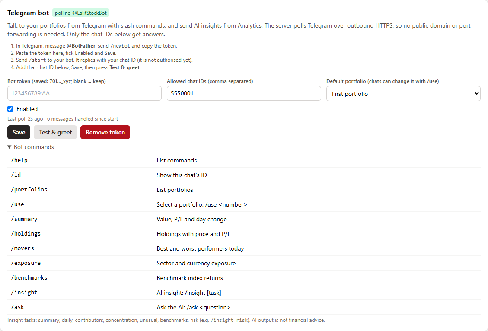 | 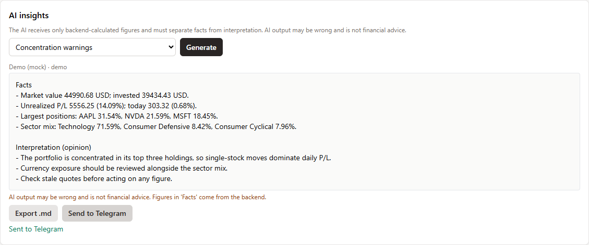 |

**Talk to your portfolio in Telegram** (replies captured from the bot on demo data):

<p align="center">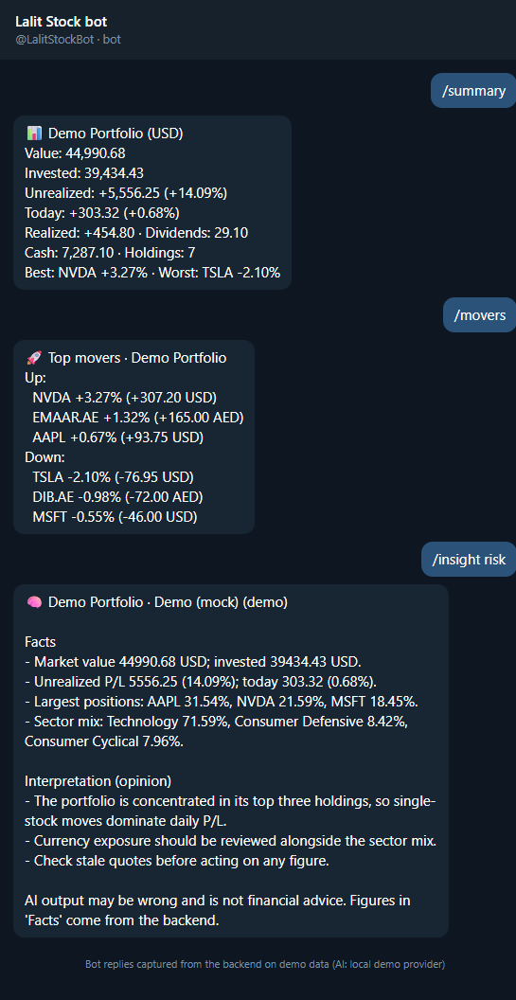</p>

| **Register a device with its E-Paper module** | **Simulator with module selection (4.2" black/white/red)** |
|---|---|
| 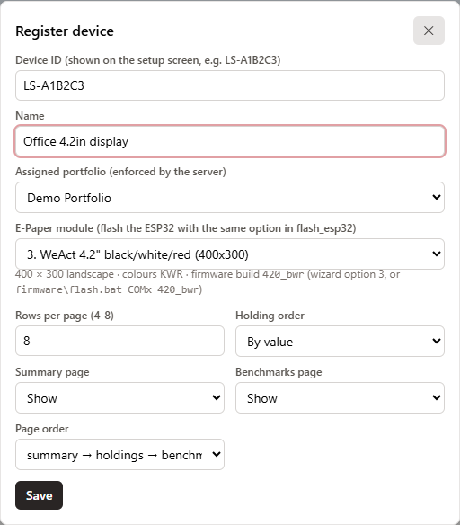 | 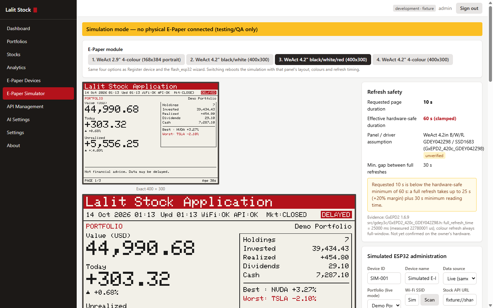 |

**The 2.9" E-Paper display** (168 × 384 portrait, rendered by the simulator with the firmware's own font and draw-ops):

| Page 1: portfolio summary | Page 2: holdings | Page 3: benchmarks |
|---|---|---|
|  |  |  |

**The 4.2" E-Paper displays** (400 × 300 landscape; each panel only gets the colours it can show):

| 4.2" black/white/red: portfolio | Holdings | Benchmarks |
|---|---|---|
| 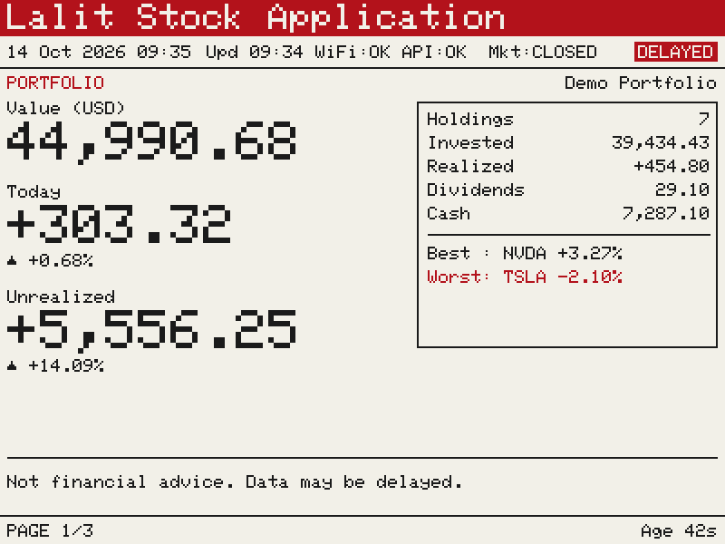 | 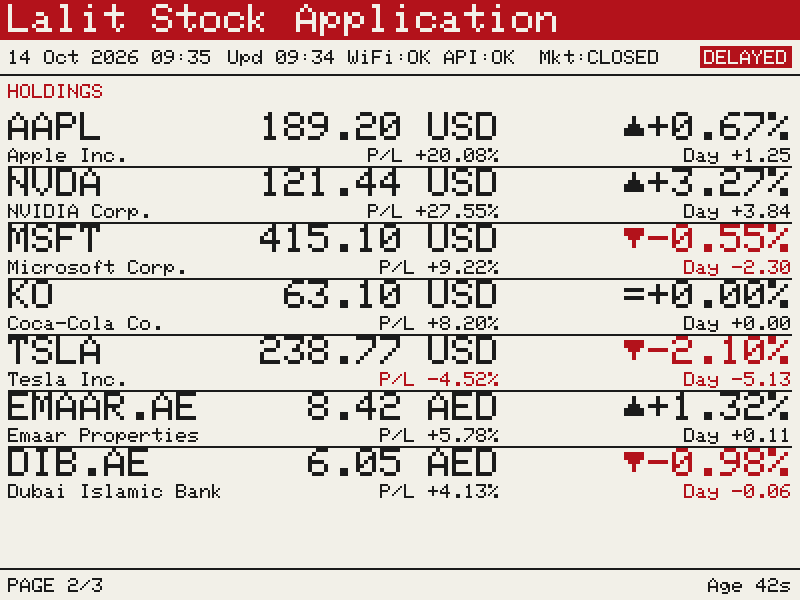 | 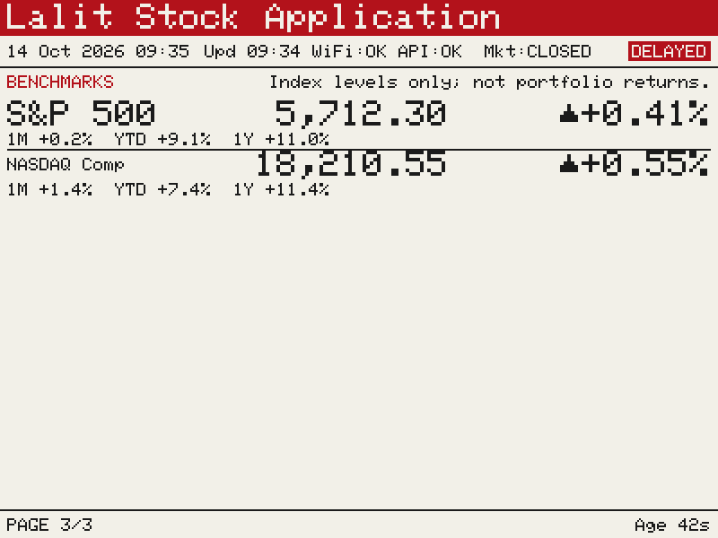 |
| **4.2" black/white: portfolio** | **Holdings (losses shown with ▼, no colour)** | **4.2" 4-colour: portfolio** |
| 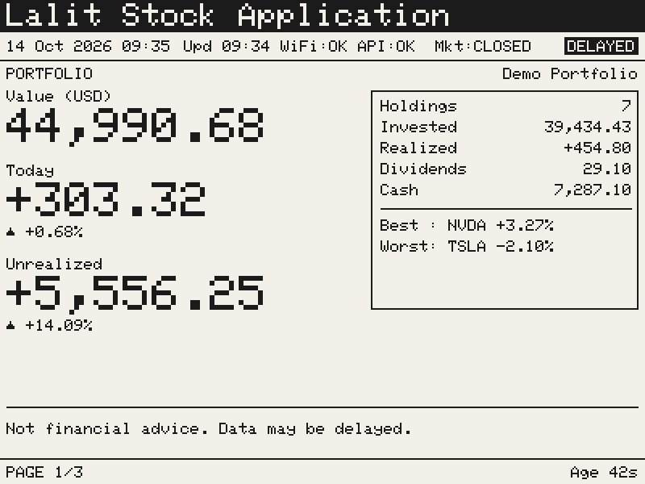 | 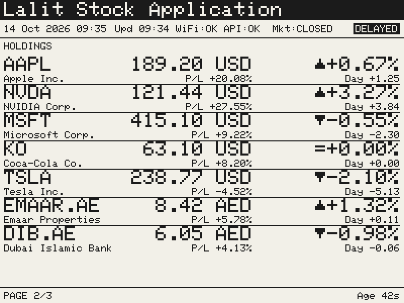 | 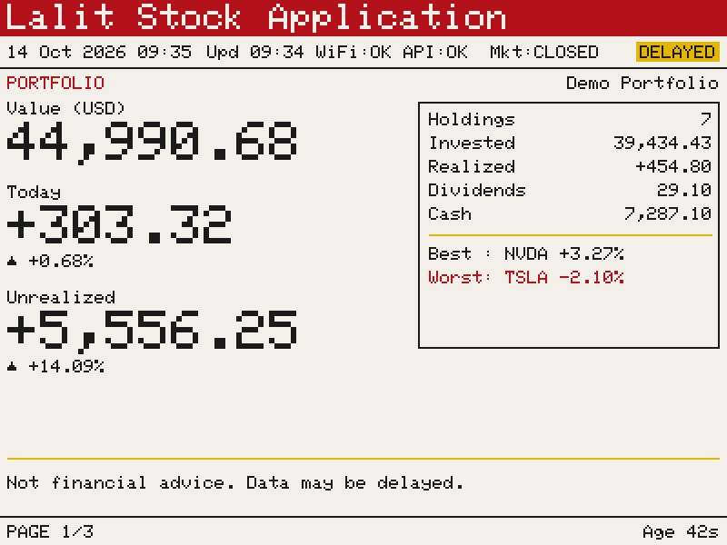 |

## Features

### Portfolio and ledger
- Multiple portfolios and brokers, each with a base currency.
- Transaction types: BUY, SELL, DIVIDEND, SPLIT, FEE, DEPOSIT, WITHDRAWAL and audited ADJUSTMENT.
- Holdings are **always recomputed from the ledger** using average-cost accounting and decimal arithmetic. Every write re-validates the whole ledger, so it can never go negative or inconsistent. FIFO is a planned extension.
- Money values are returned as decimal strings to keep full precision.

### Stock master and market data
- Create, search, edit, activate and deactivate stocks. Symbols are validated against the provider, with exchange-suffix hints (for example `EMAAR.AE` for DFM).
- Data-quality states: `ok`, `stale`, `unavailable`, `unvalidated`.
- A replaceable provider interface: Yahoo Finance (yfinance), or an offline **fixture** provider for demos and tests.
- A single central poller (default every **60 s**, configurable) with retries, exponential backoff, rate-limit handling and less frequent polling while markets are closed. The last valid quote is kept on failure. Daily history is stored.

### Analytics
- Market value, invested capital, unrealised and daily P/L, allocation, sector and currency exposure.
- Best and worst performers, data freshness, FX conversion (live quotes, with documented pegs as a fallback).
- Portfolio value history reconstructed from the ledger and daily closes.
- Benchmarks (S&P 500, NASDAQ, DFM General, FTSE ADX) shown separately from portfolio returns.

### AI insights (optional)
- One interface for **OpenAI, DeepSeek and Ollama**. Keys are encrypted at rest and masked in every response.
- **Test Connection** checks the configuration, credentials and model availability, sends a tiny request and reports latency.
- Insights: portfolio summary, top contributors, concentration risk, unusual moves, benchmark comparison, risk overview and free-form questions. The model receives only a verified fact sheet computed by the backend.
- **Export .md:** download any insight as a Markdown report (title, portfolio, provider/model, question, answer and disclaimer).
- **Send to Telegram:** deliver the same report to every allowed Telegram chat. Long reports are split to fit Telegram's message limit.
- Works with current OpenAI reasoning models (gpt-5 family): the backend sends `max_completion_tokens` and retries when a model spends its whole budget on hidden reasoning.

### Telegram bot (optional)
- **Slash commands:** `/summary`, `/holdings`, `/movers`, `/exposure`, `/benchmarks`, `/portfolios`, `/use <n>`, `/insight [task]`, `/ask <question>`, `/id` and `/help`. The commands are registered with Telegram, so they autocomplete in the chat.
- **No inbound connection needed:** the backend long-polls Telegram over outbound HTTPS. It works on a home PC, WSL2 or behind NAT, with no domain, webhook or port forwarding.
- **Private by default:** only chat IDs on your allow-list get answers. Any other chat learns only its own chat ID (so you can add it), and every attempt is written to the audit log.
- **Per-chat portfolio:** each chat picks its own portfolio with `/use`. The default portfolio is set in Settings.
- **Secrets stay secret:** the bot token is encrypted at rest, masked in the UI and API, and redacted from logs.

### ESP32 E-Paper client
- Four WeAct Studio modules on an ESP32-WROOM-32, chosen when flashing (same wiring for all):

| # | WeAct Studio module | Resolution | Colours | Panel / controller | GxEPD2 driver | Firmware build | Effective page time (10 s requested) |
|---|---|---|---|---|---|---|---|
| 1 | **2.9" 4-colour** (default) | 168 × 384 portrait | black, white, red, yellow | GDEY029F51H / JD79667 | `GxEPD2_290c_GDEY029F51H` | `290_4c` | 60 s · **hardware-verified** |
| 2 | **4.2" black/white** | 400 × 300 landscape | black, white | GDEY042T81 / SSD1683 | `GxEPD2_420_GDEY042T81` | `420_bw` | 32 s (≈1.2 s refresh) |
| 3 | **4.2" black/white/red** | 400 × 300 landscape | black, white, red | GDEY042Z98 / SSD1683 | `GxEPD2_420c_GDEY042Z98` | `420_bwr` | 60 s · **hardware-verified** (10 s measured) |
| 4 | **4.2" 4-colour** | 400 × 300 landscape | black, white, red, yellow | GDEY0420F51 / HX8717 | `GxEPD2_420c_GDEY0420F51` | `420_4c` | 66 s (≈30 s refresh) |

- **Interactive flashing wizard:** `flash_esp32.bat` (Windows) / `./flash_esp32.sh` (Linux/macOS) asks for the module, firmware or display test, and the serial port.
- The device tells the server which panel it is; the server lays out portrait or landscape pages with only that panel's colours (black/white panels show losses with ▼ arrows and inverted badges).
- Pages: portfolio summary → holdings (paginated) → benchmarks. `PAGE n/N` and data age appear on every page.
- First-boot **setup portal** (WPA2 access point), an on-device admin page, Pause/Resume/Next/Go-to-page controls, and BOOT-button recovery.
- The last good dashboard is cached in flash and shown at boot. On failure the screen shows `CACHED` / `OFFLINE <age>` and never goes blank.
- Verified TLS (built-in CA bundle or your own root CA), response size limits and structural validation.

### Security
- Admin login uses a JWT in an HttpOnly, SameSite cookie, with CSRF double-submit, server-side session revocation, rate limiting and an audit trail.
- Device API keys (`lsk_<prefix>_<secret>`) are shown once, stored as HMAC hashes, and are scoped, device-bound, expiring, rotatable, revocable and rate-limited. Every device request is logged.
- Structured JSON logs with secret redaction. HTTPS everywhere through Caddy (automatic Let's Encrypt on a VPS).

### Operations
- Docker Compose stack: PostgreSQL, FastAPI backend, React frontend, Caddy.
- `manage.sh`: an interactive menu or one-shot commands for build, start, health, logs, migrations, backup/restore, update, tests, diagnostics, reset and uninstall.

## How it works

```text
Internet ─► HTTPS / Caddy ─► React admin UI + FastAPI API ─► PostgreSQL
                                     │        ▲
                                     │        └── Market data provider (Yahoo / fixture), AI provider (optional)
                                     ▼
                       GET /api/v1/device/dashboard  (Bearer device API key)
                                     ▼
                    ESP32 ─ SPI ─► 2.9" 4-colour E-Paper (168 × 384 portrait)
```

The **server** splits the dashboard into pages and lays out each page body as simple draw-ops (text, lines, boxes). The **ESP32** and the **browser simulator** only execute those ops, adding the clock, Wi-Fi/API status, page number and data age locally. One shared contract (`shared/`) defines the settings, layout and refresh rules. It is implemented in Python, TypeScript and C++, and all three are tested against the same vectors.

| Part | Location | Technology |
|---|---|---|
| Backend API | `backend/` | Python 3.12, FastAPI, SQLAlchemy + Alembic, PostgreSQL, APScheduler, yfinance |
| Web admin + E-Paper simulator | `frontend/` | React, TypeScript, Vite, Tailwind CSS, Recharts |
| Reverse proxy / HTTPS | `deploy/Caddyfile` | Caddy 2 |
| ESP32 firmware | `firmware/LalitStockFirmware/` | Arduino-ESP32 3.3.12, GxEPD2 1.6.9 (4-colour driver), ArduinoJson 7 |
| Shared device contract | `shared/` | JSON config schema, panel profiles, layout, fixtures, test vectors |
| Operations | `manage.sh` | Interactive and non-interactive lifecycle tool (Linux, macOS, Git Bash on Windows) |
| Hardware test sketch | `ESP32_EPaper_Test/` | Display-only Hello World (`upload.bat` / `upload.sh`) |

## Quick start (local Docker)

**Prerequisites:** Docker Desktop (or Docker Engine + Compose v2), Git, and Bash (Git Bash on Windows).

```bash
git clone https://github.com/lalitnayyar/wesp32stock.git
cd wesp32stock
./manage.sh check        # verify prerequisites
./manage.sh env          # create .env, generate secrets and the first admin password
./manage.sh build
./manage.sh start        # https://localhost   (API docs: https://localhost/api/docs)
./manage.sh seed         # optional: load a demo portfolio
```

- Sign in at **https://localhost** with `ADMIN_USERNAME` / `ADMIN_PASSWORD` from `.env`, then change the password under **Settings**.
- `localhost` uses Caddy's internal CA. Trust it once with `docker compose exec web caddy trust`, or accept the browser warning.
- Other devices on your network (phone, tablet, another PC) can use **https://&lt;this-machine's-ip&gt;/**. With `LAN_ADDRESS=auto` (the default), `./manage.sh start`/`restart` detects the IP every time it runs. You can also set a fixed IP in `.env`. `./manage.sh open` prints the LAN URL. Those devices warn about Caddy's internal CA certificate. If they cannot connect, allow inbound TCP 443 in the firewall. With custom ports (`HTTP_PORT`/`HTTPS_PORT` in `.env`, for example 5174/5175), every URL carries the port: `https://localhost:5175`. On **WSL2**, see [WSL2 in DEPLOYMENT.md](docs/DEPLOYMENT.md#wsl2-docker-inside-ubuntu-on-windows); `manage.sh` detects NAT mode and prints the exact steps. The Vite dev server is also reachable at `http://<ip>:5173`.
- Offline demo: set `MARKET_PROVIDER=fixture` in `.env`.
- Windows: run `manage.sh` from Git Bash. If an antivirus or proxy inspects TLS (for example AVG Web Shield), put its root certificate in `deploy/extra-ca/`. TLS verification is never disabled.
- VPS / production: see [docs/DEPLOYMENT.md](docs/DEPLOYMENT.md). Set `SITE_ADDRESS` to your domain and Caddy obtains a Let's Encrypt certificate automatically.

## User guide: web administration

| Menu | What you do there |
|---|---|
| **Dashboard** | Portfolio value, today's and unrealised P/L, 90-day value chart, market status, data health, device status, AI status and benchmarks. |
| **Portfolios** | Create portfolios and brokers. Record transactions (BUY, SELL, DIVIDEND, SPLIT, FEE, DEPOSIT, WITHDRAWAL, ADJUSTMENT). Holdings update immediately from the ledger. |
| **Stocks** | Add symbols (validated against the provider), set name/exchange/currency/sector, activate or deactivate, refresh a quote, view history. |
| **Analytics** | Sector and currency exposure, performers today, benchmark comparison and **AI insights**, with **Export .md** and **Send to Telegram**. |
| **E-Paper Devices** | Register ESP32 devices with their **E-Paper module** (2.9" 4-colour or one of the 4.2" panels), assign a portfolio, see online/offline status, RSSI, uptime, firmware, data version, page state, and requested vs effective page duration. Preview what the device shows, for its module or any other. |
| **E-Paper Simulator** | A browser replica of the device for testing (see below). Pick any of the four **E-Paper modules** at the top; the display, colours and refresh timing switch immediately. |
| **API Management** | Create, rotate, revoke and expire device API keys, and view the per-request access log. |
| **AI Settings** | Add OpenAI / DeepSeek / Ollama providers, choose a model and run **Test Connection**. |
| **Settings** | Timezone, quote refresh interval, timeouts, retries, backoff, closed-market polling, stale threshold, heartbeat timeout, device rate limit, the admin password and the **Telegram bot** (token, allowed chats, default portfolio, status, test). |
| **About** | Version, owner, environment, link to the OpenAPI docs, and the disclaimer. |

**Typical first session**

1. **Stocks → Add stock:** for example `AAPL`, `MSFT`, `EMAAR.AE`. Wait for the status to show `ok`.
2. **Portfolios → New portfolio:** pick a base currency (for example USD or AED).
3. Open the portfolio and **Add transaction**: a DEPOSIT, then BUY lines with date, quantity, price and fees.
4. Check the **Dashboard** and **Analytics**. Quotes refresh automatically (default every 60 s). **Refresh now** forces a poll.
5. Optional: **AI Settings → Add provider → Test Connection**, then **Analytics → AI insights → Generate**.
6. Optional: **Settings → Telegram bot** to chat with your portfolio from your phone (see the next section).

## User guide: Telegram bot and insight export

### 1. Create the bot (2 minutes)

1. In Telegram, open a chat with **@BotFather** and send `/newbot`.
2. Choose a display name (e.g. *Lalit Stock*) and a username ending in `bot` (e.g. `MyLalitStockBot`).
3. BotFather replies with a **token** like `7012345678:AAF...`. Treat it like a password.

### 2. Connect it to Lalit Stock

1. Open the web admin → **Settings → Telegram bot**.
2. Paste the token, tick **Enabled** and press **Save**. The status badge changes to `polling @YourBot` within a few seconds.
3. In Telegram, open your bot and send `/start`. Because your chat isn't allowed yet, the bot replies with only:
   `This chat is not authorised. Chat ID: 123456789`.
4. Copy that number into **Allowed chat IDs** and press **Save**. Separate several IDs with commas. Group chat IDs start with `-`.
5. Press **Test & greet**. The bot checks the token, registers its slash-command menu, and sends `✅ ... is connected` to every allowed chat.
6. Optional: pick a **Default portfolio**. Otherwise the first portfolio is used.

### 3. Use it

| Command | What you get |
|---|---|
| `/summary` | Value, invested capital, unrealised and today's P/L, realised P/L, dividends, cash, best/worst holding and stale-data warnings |
| `/holdings` | Every holding with quantity, price, day change, unrealised P/L % and allocation, largest first |
| `/movers` | Top 3 gainers and losers today with their P/L |
| `/exposure` | Sector and currency exposure |
| `/benchmarks` | Benchmark index level, day, 1M, YTD and 1Y returns |
| `/portfolios`, `/use 2` | List portfolios, then switch this chat to number 2 (saved per chat) |
| `/insight risk` | An AI insight. Tasks: `summary`, `daily`, `contributors`, `concentration`, `unusual`, `benchmarks`, `risk` |
| `/ask Which holding drives my currency risk?` | A free-form AI question answered from your backend figures |
| `/id`, `/help` | This chat's ID; the command list |

AI commands use the **default AI provider** (AI Settings) and are audit-logged like web insights. All numbers come from the backend, and the AI only interprets them.

### 4. Export or send an AI insight from the web

1. **Analytics → AI insights**: choose a task (or *Ask a question*) and press **Generate**.
2. **Export .md** downloads a report such as `insight-demo-portfolio-concentration-20261013-2348.md`. It contains a heading, timestamp, provider/model, your question, the answer and the disclaimer, ready for Obsidian, GitHub or e-mail.
3. **Send to Telegram** posts the same report to every allowed chat. The button stays disabled until the bot has a token and at least one allowed chat.

### How it works and security notes

- The backend runs one background thread that long-polls `getUpdates`, so it only makes **outbound** HTTPS calls to `api.telegram.org`. Nothing has to be exposed to the internet. `TELEGRAM_API_BASE` (in `.env`) can point at a self-hosted Bot API server.
- Messages are sent as plain text (no Markdown parsing), so AI output can never break formatting. Replies over 4000 characters are split.
- Only allow-listed chats see data. Remove a chat ID or the token to cut access immediately. The status line shows the last poll, the last error and the number of messages handled.
- Anyone in an allowed **group** chat can query the bot, so allow groups deliberately.

## Step-by-step: configure a test client

There are three ways to test the device side. Start with **A**, which needs no hardware.

### A. Browser E-Paper simulator (no hardware)

1. Sign in and open **E-Paper Simulator**. The banner reads *"Simulation mode — no physical E-Paper connected"*.
2. Under **Simulated ESP32 administration**, choose a **Data source**:
   - **Fixture:** uses `shared/fixtures/dashboard_3page.json` and needs no API key. Best for a first look.
   - **Live:** builds exactly what `/api/v1/device/dashboard` returns for a chosen portfolio, authorised by your admin session.
3. Set the device settings just as on a real ESP32: device ID/name, Wi-Fi SSID (with a simulated **Scan**), API URL, fetch interval, timeout, rotation, **page duration**, rows per page, summary/benchmark pages, panel profile, timezone, POSIX TZ and NTP server.
4. Click **Save configuration**, then **Restart simulation**. The panel draws after the simulated refresh (shown as *simulated BUSY*).
5. **Usage:**
   - **Page controls:** **Pause**, **Resume**, **Next page**, **Page 1** and **Go to page N**. Changes queue behind the 30 s refresh gate, exactly like the device.
   - **Zoom:** ×1–×3 enlargement of the exact 168 × 384 canvas (nearest-neighbour, so no reflow).
   - **Refresh safety:** shows requested 10 s → effective 60 s on the verified panel. Try the `TEST_FAST_PANEL` and `UNKNOWN` (180 s fallback) profiles.
   - **Fault injection:** tick *Wi-Fi down*, *API offline*, *Stale data*, *Invalid response* or *NTP failure*, or add a *Response delay*, then **Fetch now**. The screen keeps the cached data and shows `CACHED` / `OFFLINE`.
   - **Diagnostics and events:** fetch counts, page changes, heartbeats and cache age. These confirm that page changes never trigger fetches.
   - **Reset simulator** clears only the simulator state (it asks for confirmation).

Details: [docs/SIMULATOR.md](docs/SIMULATOR.md).

### B. Command-line API test client (curl)

This tests the exact endpoint the ESP32 uses.

1. **E-Paper Devices → Register device:** enter a device ID (for example `TEST-CLI-01`) and a name, then assign a portfolio.
2. **API Management → Create API key:** select the device and the scopes `device:dashboard` and `device:heartbeat`, optionally with an expiry. **Copy the key now.** It is shown only once.
3. Export it in your shell, without putting it in files you commit:
   ```bash
   export LSK='lsk_xxxxxxxx_yyyyyyyyyyyy'
   export BASE='https://localhost'          # or https://stock.example.com
   ```
4. **Fetch the dashboard:**
   ```bash
   curl -sk -H "Authorization: Bearer $LSK" \
        "$BASE/api/v1/device/dashboard?rows=8&summary=true&bench=true" | python -m json.tool
   ```
   The response is the render contract: `data_version`, page count and draw-ops per page ([docs/RENDER_CONTRACT.md](docs/RENDER_CONTRACT.md)). `-k` is only needed for the local Caddy CA. Do not use it against a real domain.
5. **Conditional fetch:** send back the version you hold. The server answers `304 Not Modified` if nothing changed.
   ```bash
   curl -sk -o /dev/null -w "%{http_code}\n" -H "Authorization: Bearer $LSK" \
        "$BASE/api/v1/device/dashboard?since=<data_version>"
   ```
6. **Send a heartbeat** so the device shows **online** under E-Paper Devices:
   ```bash
   curl -sk -X POST -H "Authorization: Bearer $LSK" -H "Content-Type: application/json" \
        -d '{"firmware":"cli-test","rssi":-60,"uptime_s":120,"api_status":"OK","page":1,"pages":3,
             "rotation_enabled":true,"requested_s":10,"effective_s":60,"panel_profile":"JD79667_GDEY029F51H"}' \
        "$BASE/api/v1/device/heartbeat"
   ```
7. **Check the log:** **API Management → Logs** lists each request with status and IP. Try a wrong key (`401`) or a revoked key to see the rejection. When you have finished, **revoke** the test key.

Full API reference: [docs/API.md](docs/API.md) and the live OpenAPI UI at `/api/docs`.

### C. Physical ESP32 + WeAct E-Paper (2.9" 4-colour or 4.2" 400 × 300)

**Hardware:** ESP32-WROOM-32 (*ESP32 Dev Module*) and one of these WeAct Studio E-Paper modules. The module type is printed on its flex cable and on the WeAct product page.

| # | WeAct Studio module | Resolution | Colours | Panel / controller | GxEPD2 driver | Firmware build | Effective page time (10 s requested) |
|---|---|---|---|---|---|---|---|
| 1 | **2.9" 4-colour** (default) | 168 × 384 portrait | black, white, red, yellow | GDEY029F51H / JD79667 | `GxEPD2_290c_GDEY029F51H` | `290_4c` | 60 s · **hardware-verified** |
| 2 | **4.2" black/white** | 400 × 300 landscape | black, white | GDEY042T81 / SSD1683 | `GxEPD2_420_GDEY042T81` | `420_bw` | 32 s (≈1.2 s refresh) |
| 3 | **4.2" black/white/red** | 400 × 300 landscape | black, white, red | GDEY042Z98 / SSD1683 | `GxEPD2_420c_GDEY042Z98` | `420_bwr` | 60 s · **hardware-verified** (10 s measured) |
| 4 | **4.2" 4-colour** | 400 × 300 landscape | black, white, red, yellow | GDEY0420F51 / HX8717 | `GxEPD2_420c_GDEY0420F51` | `420_4c` | 66 s (≈30 s refresh) |

All four modules have the same 8-pin header. Two wiring layouts are supported; pick the one you used in the flashing wizard (step 2) or as the third argument of `flash.bat` / `upload.bat` (`standard` or `uart2`):

| E-Paper pin | Cable (WeAct) | 1. Standard (default) | 2. TX2/RX2 (`uart2`) |
|---|---|---|---|
| VCC | red | **3V3 only** | **3V3 only** |
| GND | black | GND | GND |
| SDA (SPI MOSI) | yellow | GPIO23 | GPIO23 |
| SCL (SPI clock) | green | GPIO18 | GPIO18 |
| CS | blue | GPIO5 | GPIO5 |
| D/C | white | GPIO25 | **TX2 (GPIO17)** |
| RES | orange | GPIO26 | **RX2 (GPIO16)** |
| BUSY | purple | GPIO4 | GPIO4 |

<p align="center">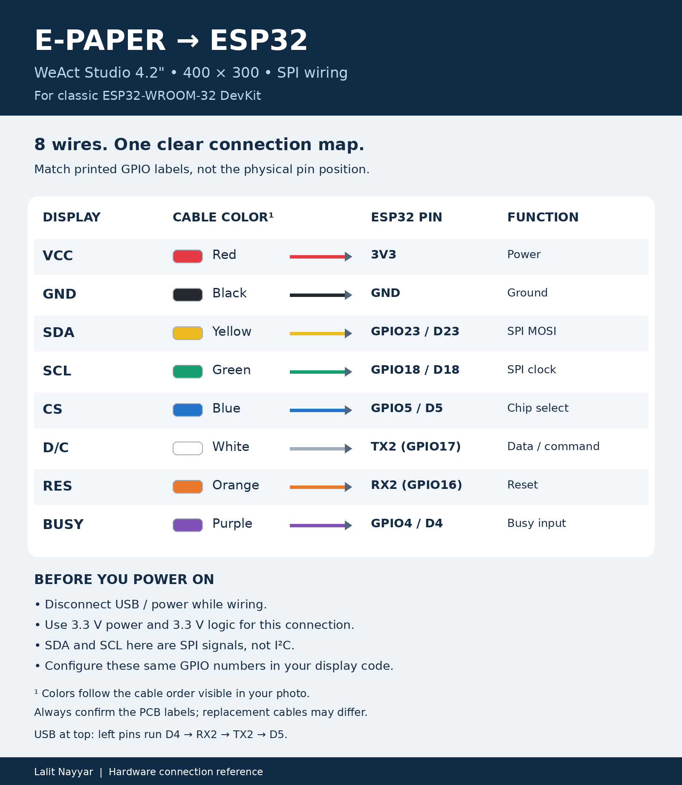</p>

The TX2/RX2 layout keeps every wire on the left header of a classic ESP32-WROOM-32 DevKit (USB at the top: D4 → RX2 → TX2 → D5). Do not use it on WROVER boards, where GPIO16/17 belong to the PSRAM. If the firmware and the wiring disagree, the panel stays blank and the boot log shows a refresh that "finishes" in a few milliseconds instead of 10-30 s; the boot log prints `[hw] panel ..., wiring ...` so you can check.

**Easiest: the flashing wizard.** Plug in the ESP32 and run `flash_esp32.bat` (Windows, double-click or from a prompt) or `./flash_esp32.sh` (Linux/macOS). It asks four questions and shows a summary before anything is written:

```text
Step 1/4 - Which E-Paper module is connected to the ESP32?
  1. WeAct 2.9in 4-colour        168 x 384 portrait    GDEY029F51H / JD79667  [hardware-verified]
  2. WeAct 4.2in black/white     400 x 300 landscape   GDEY042T81 / SSD1683   fast refresh, ~32 s pages
  3. WeAct 4.2in black/white/red 400 x 300 landscape   GDEY042Z98 / SSD1683   ~60 s pages
  4. WeAct 4.2in 4-colour        400 x 300 landscape   GDEY0420F51 / HX8717   ~66 s pages
Step 2/4 - How is the module wired to the ESP32?   1. Standard (D/C 25, RES 26)   2. TX2/RX2 (D/C 17, RES 16)
Step 3/4 - What do you want to flash?   1. Lalit Stock firmware   2. Display test (Hello World)
Step 4/4 - Which serial port is the ESP32 on?   1. COM3  serial  Serial Port (USB)
  Module : WeAct 4.2in black/white/red, 400x300   (build 420_bwr)
  Wiring : TX2/RX2, D/C 17, RES 16
Proceed? [Y/n]
```

Choose the **same module** when you register the device in the web admin (step 3).

1. **Check the display first:** run the wizard and choose *Display test*, or `upload.bat COM3 <build> [wiring]` / `./upload.sh [port] <build> [wiring]` (for example `upload.bat COM3 420_bwr uart2`). It flashes the Hello World sketch in `ESP32_EPaper_Test/` for that module. Continue only when it shows on the panel.
2. **Flash the firmware:** run the wizard and choose *Lalit Stock firmware*, or `firmware\flash.bat COM3 <build> [wiring]` (Windows) / `firmware/flash.sh [/dev/ttyUSB0] <build> [wiring]` (Linux/macOS), where `<build>` is `290_4c` (default), `420_bw`, `420_bwr` or `420_4c` and `[wiring]` is `standard` (default) or `uart2`. With no port, the Linux script uses the first `/dev/ttyUSB*` or `/dev/ttyACM*`. Your user must be in the `dialout` group (`sudo usermod -aG dialout $USER`, then log in again). Set `NO_MONITOR=1` to skip the serial monitor. Either script installs the ESP32 core and libraries, compiles with `PartitionScheme=min_spiffs`, uploads and opens the serial monitor. Manual equivalent:
   ```bash
   arduino-cli compile --fqbn esp32:esp32:esp32:PartitionScheme=min_spiffs \
     --build-property "compiler.cpp.extra_flags=-DLS_PANEL=LS_PANEL_420_BWR" firmware/LalitStockFirmware
   arduino-cli upload  -p COM3 --fqbn esp32:esp32:esp32:PartitionScheme=min_spiffs firmware/LalitStockFirmware
   ```
3. **Server side:** in **E-Paper Devices → Register device**, enter the device ID shown on the E-Paper setup screen (for example `LS-A1B2C3`), choose the **E-Paper module** (the same option as in the wizard) and assign a portfolio. In **API Management**, create a key for that device and copy it.
4. **Setup portal (first boot):** the device opens a WPA2 access point `LalitStock-Setup-XXXX`, with the password shown on the E-Paper and on serial. Connect to it and browse to **http://192.168.4.1**.
5. Enter the Wi-Fi SSID and password, the **API URL** (for example `https://stock.example.com`), the **device API key**, and an **admin password** (at least 8 characters). Click **Test Wi-Fi** and **Test API**, then **Save**. The device restarts into normal mode.
6. **Usage:**
   - The panel rotates *Portfolio → Holdings → Benchmarks* at the module's effective safe duration (60 s on the 2.9", 32/60/66 s on the 4.2" B/W, B/W/R and 4-colour), with `PAGE n/N` and the data age in the footer.
   - Device admin page: `http://<device-ip>/`, with user `admin` and your admin password. It offers Pause/Resume, Next page, Go to page N, status and diagnostics, all settings, Test Wi-Fi/API, Restart and Factory reset (type `RESET`).
   - The device should show **online** in **E-Paper Devices** within one heartbeat interval.
7. **Recovery (BOOT button, GPIO0):** hold for **5 s** to return to the setup portal with settings kept. Hold for **15 s** to factory reset.

#### Connecting the ESP32 over your home network (no domain): worked example

This is the configuration verified on a Windows PC running the stack in WSL2 (PC `192.168.68.135`, ESP32 `192.168.68.105`, web ports 5174/5175, device port 8174):

| Where | Setting | Value |
|---|---|---|
| Server `.env` | `HTTP_PORT` / `HTTPS_PORT` | `5174` / `5175` (any free ports; the web UI becomes `https://<pc-ip>:5175`) |
| Server `.env` | `DEVICE_LAN_BIND` / `DEVICE_LAN_PORT` | `0.0.0.0` / `8174`, then `./manage.sh start` |
| Web UI → E-Paper Devices | Register device | Device ID from the ESP32 setup screen, e.g. `LS-546534` (`LS-` + last 3 bytes of the Wi-Fi MAC). Assign a portfolio. |
| Web UI → E-Paper Devices | **New API key** on that device's row | Creates a key **bound to the device**. Copy it; it is shown once. |
| ESP32 admin page | API URL | `http://192.168.68.135:8174`: **http**, the PC's LAN IP, the device port, **no trailing path** |
| ESP32 admin page | API key | The bound key. Click **Save first**, then **Test API**. |
| Windows (WSL2 mirrored mode only) | Inbound firewall | Admin PowerShell: `New-NetFirewallHyperVRule -Name LalitStock -DisplayName 'Lalit Stock' -Direction Inbound -VMCreatorId '{40E0AC32-46A5-438A-A0B2-2B479E8F2E90}' -Protocol TCP -LocalPorts 8174,5175,5174 -Action Allow` |

When it works, the device status shows **API `OK (INSECURE HTTP)`**, the fetch count increases and the NTP time is set, and the device shows **online** in E-Paper Devices. The device port is plain HTTP, so use it only on a trusted network. For HTTPS, use `https://<your-domain>` on a VPS, or paste Caddy's root CA into the device's *custom root CA* field.

`http://<pc-ip>:8174/` itself answers `{"error":{"status":404,...}}` in a browser. That is expected: it is the API base. `http://<pc-ip>:8174/api/health` returns `{"status":"ok"}`.

Full guide: [docs/ESP32_SETUP.md](docs/ESP32_SETUP.md) · wiring reference: [ESP32_WeAct_2.9_EPaper.md](ESP32_WeAct_2.9_EPaper.md)

## E-Paper pagination and refresh safety

Every supported panel is a full-page display, so the device rotates **pages**. It never scrolls. The 2.9" panel uses a 168 × 384 portrait layout; the 4.2" panels use a 400 × 300 landscape layout with larger, two-line rows (symbol, price and day % in large text; company, P/L and day change below).

- Rotation is enabled by default. Pages advance 1 → N and wrap back to 1, with `PAGE n/N` on every page.
- **Pause / Resume**, **Next page** and **Go to page N** are available on the device admin page and in the simulator. Manual changes queue behind the refresh guard. The paused state and the selected page persist across reboots.
- The **requested** default duration is **10 s**. A full refresh of this panel takes up to 25 s (GxEPD2 `full_refresh_time`; measured 21.4 s), so the firmware enforces an **effective hardware-safe duration**: `max(requested, ceil(25 s × 1.2) + 30 s) = 60 s`. Both values and the reason are shown on the device page, in the simulator and in device diagnostics. The 4.2" panels use the same formula with their GxEPD2 timings: black/white 1.2 s → **32 s**, black/white/red 25 s → **60 s**, 4-colour 30 s → **66 s** (not yet measured on hardware). Unknown panels use a 180 s fallback. See [docs/HARDWARE_VERIFICATION.md](docs/HARDWARE_VERIFICATION.md).
- API polling, page rotation, heartbeat and NTP run on **independent** schedules. A page change never triggers a fetch, and a slow fetch (on its own FreeRTOS task) never blocks rotation.
- On failure the display keeps the cached data and shows `CACHED` / `OFFLINE <age>`. It never blanks.

## Troubleshooting

Common problems, from real deployments. More in [docs/TROUBLESHOOTING.md](docs/TROUBLESHOOTING.md).

**Web UI**

| Symptom | Cause and fix |
|---|---|
| `https://localhost` does not open after choosing custom ports | URLs carry the port: `https://<ip>:<HTTPS_PORT>`, e.g. `https://192.168.68.135:5175`. `./manage.sh open` prints the right URLs. |
| `ERR_CONNECTION_REFUSED` on every URL | The stack is not running (for example after **Uninstall**). Run `./manage.sh start` and `./manage.sh health`. |
| Web container keeps restarting with `ambiguous site definition` | `SITE_ADDRESS` equals the LAN IP. Current `manage.sh` handles this; run `./manage.sh pull` and start through `manage.sh`, not plain `docker compose`. |
| WSL2: works on `localhost` but not on the IP | NAT mode: use mirrored networking (`[wsl2] networkingMode=mirrored` in `%UserProfile%\.wslconfig`, then `wsl --shutdown`). Mirrored mode: same-PC access to the IP needs `[experimental] hostAddressLoopback=true`, and other devices need the Hyper-V firewall rule above. `./manage.sh health` prints these hints. |

**Telegram bot**

| Symptom | Cause and fix |
|---|---|
| Badge says `starting / error`, last error `Unauthorized` | The token is wrong or was revoked in @BotFather. Paste a fresh token and **Save**. |
| Last error `Conflict: terminated by other getUpdates request` | The same token is used by another program or a second Lalit Stock install. Each token can be polled by only one server. |
| Last error mentions `webhook` | The token has a webhook set by another tool. In a browser, open `https://api.telegram.org/bot<token>/deleteWebhook` once. |
| Bot replies "This chat is not authorised" | Add the chat ID it shows to **Allowed chat IDs** and **Save**. |
| `/insight` says no AI provider | Add a provider under **AI Settings** and mark it **Default**. |
| `Telegram unreachable: ConnectError` | The server has no outbound internet access to `api.telegram.org` (firewall or proxy). Behind TLS-inspecting antivirus, add its root CA to `deploy/extra-ca/`. |
| AI test fails: `Unsupported parameter: 'max_tokens'` | Fixed in current code (gpt-5 models need `max_completion_tokens`). Run `./manage.sh update`. |

**ESP32**

| Device status | Cause and fix |
|---|---|
| Wi-Fi OK, API `OFF`, fetches `0/0`, NTP not synced | The device is still in **setup mode**. It only starts fetching after Wi-Fi, API URL, API key **and** admin password are all saved. |
| `connection failed: connection refused` | The PC isn't reachable on that port: `DEVICE_LAN_BIND` is still `127.0.0.1`, the Windows/Hyper-V firewall rule is missing, or the URL has the wrong port. Also note that **Test API checks the saved settings**, so press **Save** before testing new values. |
| `HTTP 403` / `API key rejected` | The key is not **bound to a device**, or it is bound to a different device ID, revoked or expired. Create the key from the device's row in **E-Paper Devices**. |
| `HTTP 401` | The key is mistyped or was revoked. Keys are shown only once, so create a new one. |
| TLS / handshake error with `https://<ip>:5175` | The ESP32 does not trust Caddy's local CA. Use `http://<pc-ip>:<DEVICE_LAN_PORT>` on a LAN, or a real domain with Let's Encrypt. |
| Panel stays blank; boot log shows `_Update_... : 5` (a refresh "finishing" in milliseconds) | The firmware's wiring does not match the cables (most often D/C and RES). Reflash with the right wiring option: *standard* (D/C 25, RES 26) or *TX2/RX2* (D/C 17, RES 16). The boot log line `[hw] panel ..., wiring ...` shows what was built. |
| 4.2" panel blank, garbled, or only half drawn | The firmware was built for another module. Run the wizard again and pick the module printed on the flex cable; check with the *Display test* first. |
| `invalid response: layout is not 400x300` (or `168x384`) | The server laid out pages for a different panel. Update the server (`./manage.sh update`); the device sends its panel with every fetch. A cached page from the previous panel is discarded after reflashing. |
| Device card says "registered as … but the device runs firmware for …" | The module chosen at registration differs from the flashed firmware. The device's own panel is used; edit the device (**Configure**) or reflash with the matching module. |
| `401` when opening the device admin page | It uses its **own** admin password (set in the setup portal), not the web-app login. Forgot it? Hold BOOT for 15 s to factory reset. |

## Operations with `manage.sh`

Run `./manage.sh` with no arguments for the interactive menu, or use a subcommand (`-y` = assume yes):

| Command | Purpose | Command | Purpose |
|---|---|---|---|
| `check` | Install/check prerequisites | `health` | Run health checks |
| `env` | Create or edit `.env` | `migrate` | Run database migrations |
| `secrets` | Generate missing secrets | `seed` | Load optional demo data |
| `build` | Build images | `backup` | Timestamped DB backup |
| `start` / `stop` / `restart` | Service lifecycle | `restore [F]` | Restore a backup (asks for confirmation) |
| `status` | Service status | `update` | Back up DB, pull from GitHub, rebuild, migrate, restart |
| `pull` | Pull latest code from GitHub only (no rebuild; keeps `.env`, backups, logs) | | |
| `logs [svc]` | Follow logs | `open` | Show/open web and API URLs |
| `diag` | Diagnostics (secrets redacted) | `test [backend\|frontend\|firmware\|all]` | Run test suites |
| `reset` | Remove demo data / reset data (asks for confirmation) | `help` | Help and disclaimer |
| `uninstall` | Remove the application (levels below) | | |

**Uninstall** (`./manage.sh uninstall`, menu option 21) offers three levels. Source code, `.env` and `backups/` are always kept:

1. Remove containers and the network. Data is kept, and `./manage.sh start` restores everything.
2. Also remove the application images. Data is kept; run `./manage.sh build` before starting again.
3. Also **delete all data**: the database, certificates and Caddy state. You must type `DELETE`, and a final backup is taken first.

With `-y` it defaults to level 1; set `UNINSTALL_LEVEL=2` or `3` to choose another level. To remove the application completely, run level 3 and then delete the project folder.

Exit codes: `0` ok, `1` failure, `2` usage, `3` missing prerequisite, `4` aborted. Log file: `logs/manage.log`. Backups: [docs/BACKUP_RESTORE.md](docs/BACKUP_RESTORE.md).

## Development and tests

```bash
./manage.sh test                 # all suites
./manage.sh test backend         # pytest (SQLite + fixture market provider)
./manage.sh test frontend        # tsc + vitest (includes the simulator rules)
./manage.sh test firmware        # g++ host tests of logic.h + arduino-cli compile

cd frontend && npm run dev       # Vite on :5173, proxies /api to localhost:8000
python tools/gen_shared.py       # regenerate derived contract files (tests fail if stale)
```

The Python, TypeScript and C++ implementations of the device rules all run against the same vectors in `shared/test_vectors/`.

## Repository layout

```text
backend/            FastAPI app, services (ledger, market data, dashboard builder, AI), Alembic, tests
frontend/           React admin UI and E-Paper simulator (src/sim)
firmware/           ESP32 firmware (LalitStockFirmware/), host tests, flash.bat / flash.sh [port] [build]
flash_esp32.bat/.sh Interactive flashing wizard: choose the E-Paper module, firmware or display test, and port
shared/             Device contract: config schema, panel profiles (+ palettes), layouts (168x384, 400x300), fixtures, test vectors
deploy/             Caddyfile, extra-ca/ for TLS-inspecting proxies
docs/               Deployment, API, ESP32 setup, render contract, simulator, backup, troubleshooting, screenshots
tools/gen_shared.py Generator for derived contract files
tools/esp32_flash.sh Shared compile/upload helper for flash.sh and upload.sh
ESP32_EPaper_Test/  Display-only hardware test sketch
manage.sh           Operations tool (bash: Linux, macOS, Git Bash)
upload.bat / .sh    Flash the hardware test sketch for a module (Windows / Linux): upload.bat COM3 420_bwr
push.bat / .sh      Commit everything and push the current branch (Windows / Linux)
```

## Documentation index

- [docs/DEPLOYMENT.md](docs/DEPLOYMENT.md): local Docker, Hostinger VPS, Caddy/TLS, environment
- [docs/API.md](docs/API.md): REST API overview (full OpenAPI at `/api/docs`)
- [docs/ESP32_SETUP.md](docs/ESP32_SETUP.md): flashing, first-boot setup portal, admin page, recovery
- [docs/RENDER_CONTRACT.md](docs/RENDER_CONTRACT.md): dashboard payload and draw-op format
- [docs/SIMULATOR.md](docs/SIMULATOR.md): E-Paper simulator
- [docs/BACKUP_RESTORE.md](docs/BACKUP_RESTORE.md) · [docs/TROUBLESHOOTING.md](docs/TROUBLESHOOTING.md)
- [docs/HARDWARE_VERIFICATION.md](docs/HARDWARE_VERIFICATION.md): panel/driver evidence and open hardware-in-the-loop items
- Hardware: [ESP32_WeAct_2.9_EPaper.md](ESP32_WeAct_2.9_EPaper.md), [ESP32_WeAct_2_9_4C_Setup_Reference.md](ESP32_WeAct_2_9_4C_Setup_Reference.md)
- Specification: [prompt.md](prompt.md)

## Support and contact

**Lalit Nayyar** · consult@lalit.cloud · +971568391973

For consulting, custom deployments or hardware kits, get in touch by email.

---

<sub>**Disclaimer:** Lalit Stock Application is informational software and **not financial advice**. Market data may be delayed, incomplete, inaccurate, rate-limited or unavailable, and AI output may be wrong. Always verify information independently before making investment decisions. Provided as is, without warranty of any kind. © Lalit Nayyar.</sub>
