# Lalit Stock Application

**Your stock portfolio, always on the desk: a self-hosted portfolio tracker with a web admin console and a low-power ESP32 four-colour E-Paper display.**

**Owner:** Lalit Nayyar · consult@lalit.cloud · +971568391973 · default timezone `Asia/Dubai`

> ### ⚠️ Disclaimer: not financial advice
> This software is **informational only and is not financial advice**. Market data may be delayed, incomplete, inaccurate, rate-limited or unavailable. AI output may be wrong. The operator is responsible for credentials, network security, backups, licensing, data-provider terms, and for validating all financial information before relying on it. The software is provided **as is, without warranty** of fitness for a particular purpose, uninterrupted availability or investment performance. Nothing shown by the application, the E-Paper device or the AI assistant is a recommendation to buy, sell or hold any security.

<p align="center">
  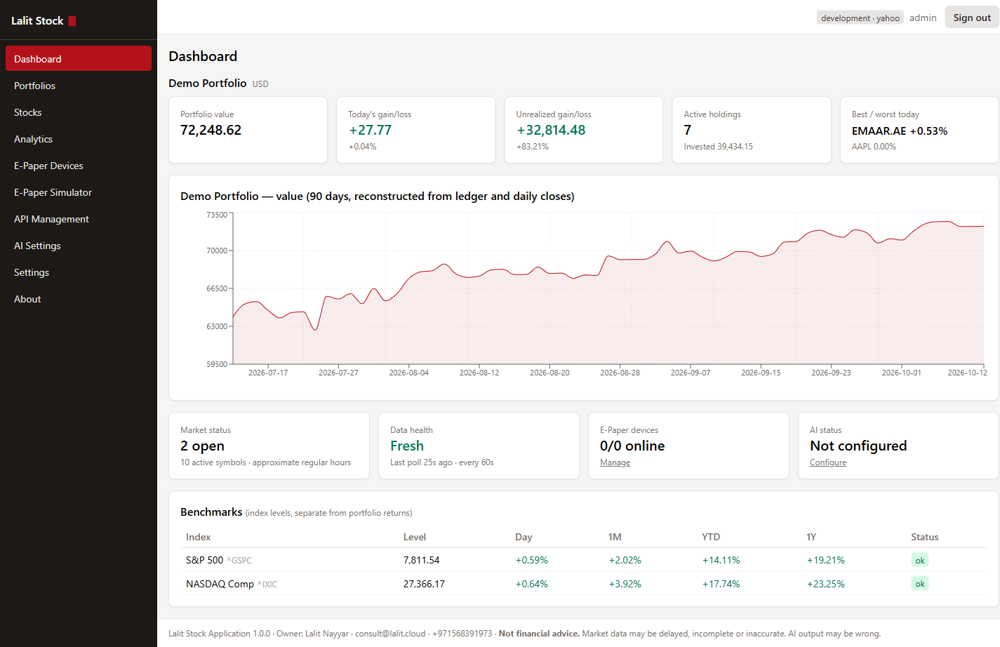
  &nbsp;
  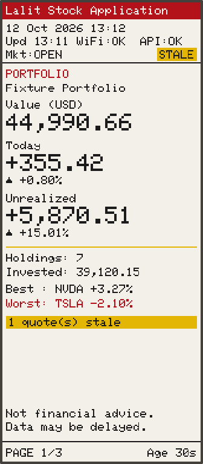
</p>

---

## Contents

1. [Why Lalit Stock](#why-lalit-stock)
2. [Screenshots](#screenshots)
3. [Features](#features)
4. [How it works](#how-it-works)
5. [Quick start](#quick-start-local-docker)
6. [User guide: web administration](#user-guide-web-administration)
7. [Step-by-step: configure a test client](#step-by-step-configure-a-test-client)
8. [E-Paper pagination and refresh safety](#e-paper-pagination-and-refresh-safety)
9. [Operations with `manage.sh`](#operations-with-managesh)
10. [Development and tests](#development-and-tests)
11. [Repository layout](#repository-layout)
12. [Documentation index](#documentation-index)
13. [Support and contact](#support-and-contact)

---

## Why Lalit Stock

- **Glanceable:** a 2.9-inch red/yellow/black/white E-Paper panel shows portfolio value, today's gain/loss and every holding. It draws no power between refreshes and needs no screen time.
- **Private:** everything runs on your own Docker host or VPS. Your ledger never leaves your server.
- **Accurate:** holdings are replayed from an audited transaction ledger with decimal-safe average-cost accounting.
- **Honest data:** stale and unavailable quotes are labelled on the web and on the device. The last good data is never silently replaced.
- **Multi-market:** US, UAE (DFM `.AE`, ADX) and other Yahoo-covered exchanges, with FX conversion and benchmark comparison.
- **Optional AI insights:** OpenAI, DeepSeek or a local Ollama model explains the backend-calculated figures. The AI never sees raw credentials and never computes numbers itself.
- **Testable without hardware:** a pixel-exact browser simulator of the E-Paper device is built in.

## Screenshots

| Dashboard | Analytics |
|---|---|
|  | 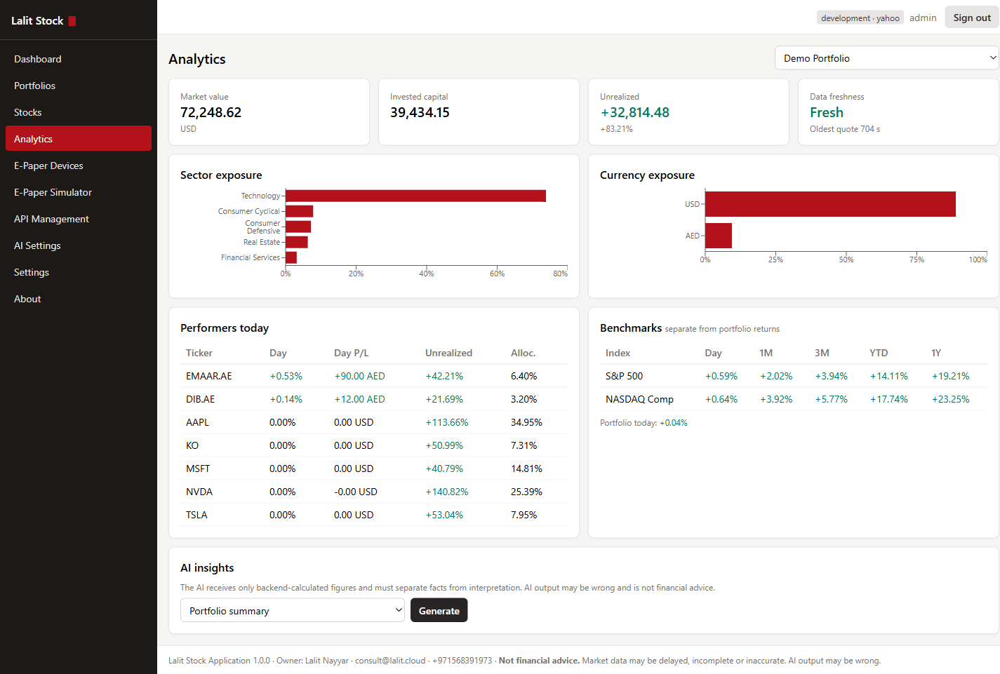 |
| **Portfolios and ledger** | **Stock master** |
| 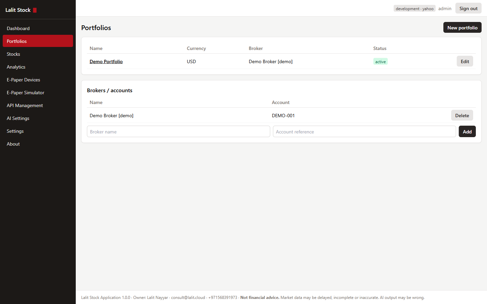 | 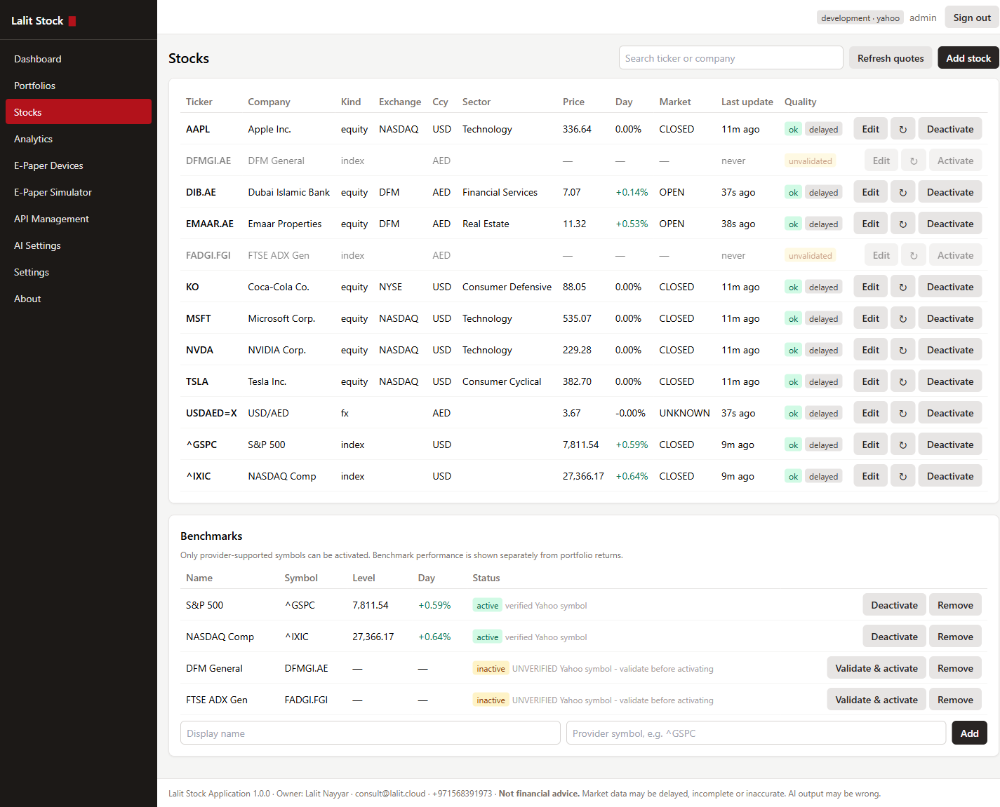 |
| **E-Paper simulator** | **E-Paper devices** |
| 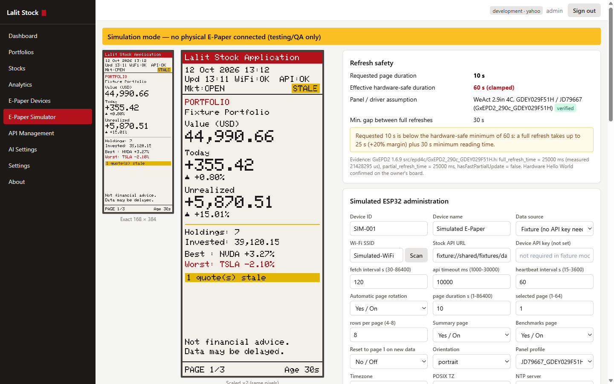 | 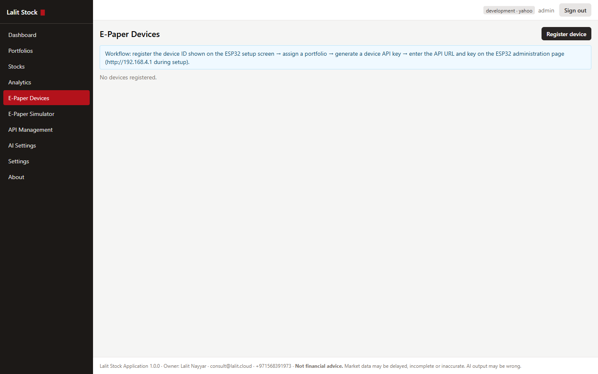 |
| **Device API keys** | **Settings** |
| 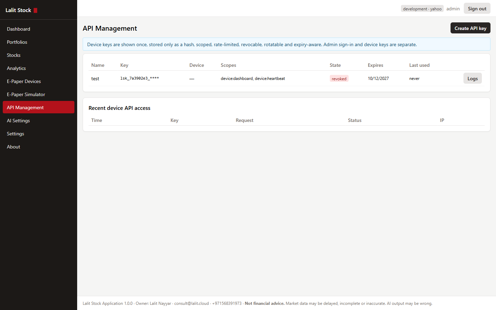 | 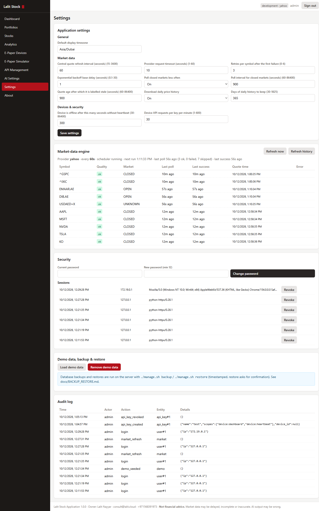 |
| **AI settings** | **About and disclaimer** |
| 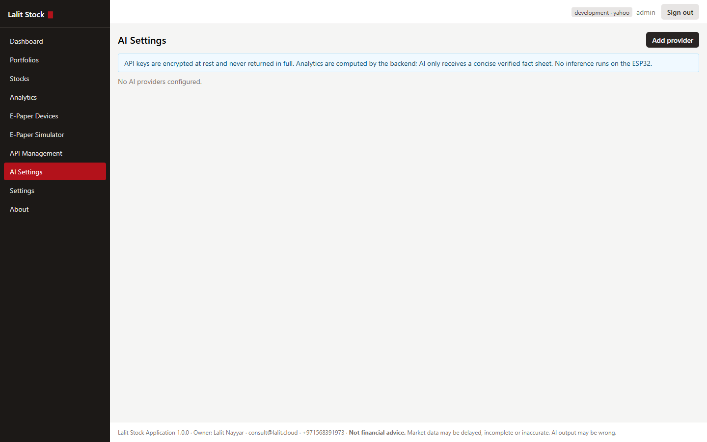 | 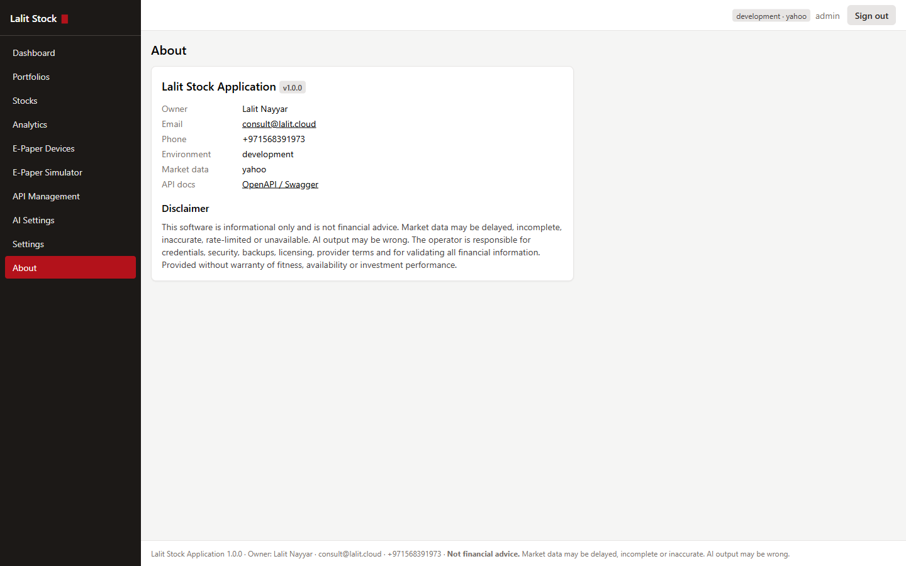 |

**The E-Paper display** (168 × 384 portrait, rendered by the simulator with the firmware's own font and draw-ops):

| Page 1: portfolio summary | Page 2: holdings | Page 3: benchmarks |
|---|---|---|
|  | 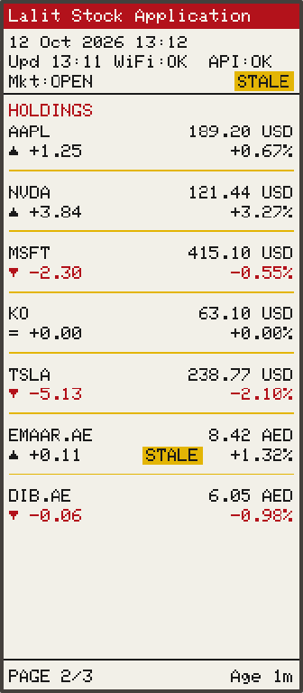 | 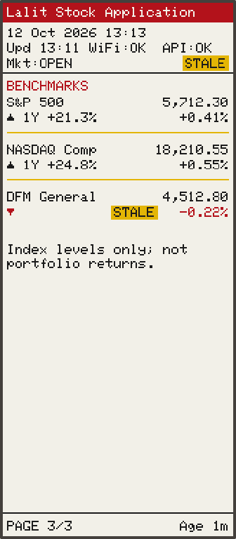 |

## Features

### Portfolio and ledger
- Multiple portfolios and brokers, each with a base currency.
- Transaction types: BUY, SELL, DIVIDEND, SPLIT, FEE, DEPOSIT, WITHDRAWAL and audited ADJUSTMENT.
- Holdings are **always recomputed from the ledger** using average-cost accounting and decimal arithmetic. Every write re-validates the whole ledger, so it can never go negative or inconsistent. FIFO is a planned extension.
- Money values are returned as decimal strings to keep full precision.

### Stock master and market data
- Create, search, edit, activate and deactivate stocks. Symbols are validated against the provider, with exchange-suffix hints (for example `EMAAR.AE` for DFM).
- Data-quality states: `ok`, `stale`, `unavailable`, `unvalidated`.
- A replaceable provider interface: Yahoo Finance (yfinance), or an offline **fixture** provider for demos and tests.
- A single central poller (default every **60 s**, configurable) with retries, exponential backoff, rate-limit handling and less frequent polling while markets are closed. The last valid quote is kept on failure. Daily history is stored.

### Analytics
- Market value, invested capital, unrealised and daily P/L, allocation, sector and currency exposure.
- Best and worst performers, data freshness, FX conversion (live quotes, with documented pegs as a fallback).
- Portfolio value history reconstructed from the ledger and daily closes.
- Benchmarks (S&P 500, NASDAQ, DFM General, FTSE ADX) shown separately from portfolio returns.

### AI insights (optional)
- One interface for **OpenAI, DeepSeek and Ollama**. Keys are encrypted at rest and masked in every response.
- **Test Connection** checks the configuration, credentials and model availability, sends a tiny request and reports latency.
- Insights: portfolio summary, top contributors, concentration risk, unusual moves, benchmark comparison, risk overview and free-form questions. The model receives only a verified fact sheet computed by the backend.

### ESP32 E-Paper client
- WeAct Studio 2.9" **4-colour** panel (GDEY029F51H / JD79667) on an ESP32-WROOM-32.
- Pages: portfolio summary → holdings (paginated) → benchmarks. `PAGE n/N` and data age appear on every page.
- First-boot **setup portal** (WPA2 access point), an on-device admin page, Pause/Resume/Next/Go-to-page controls, and BOOT-button recovery.
- The last good dashboard is cached in flash and shown at boot. On failure the screen shows `CACHED` / `OFFLINE <age>` and never goes blank.
- Verified TLS (built-in CA bundle or your own root CA), response size limits and structural validation.

### Security
- Admin login uses a JWT in an HttpOnly, SameSite cookie, with CSRF double-submit, server-side session revocation, rate limiting and an audit trail.
- Device API keys (`lsk_<prefix>_<secret>`) are shown once, stored as HMAC hashes, and are scoped, device-bound, expiring, rotatable, revocable and rate-limited. Every device request is logged.
- Structured JSON logs with secret redaction. HTTPS everywhere through Caddy (automatic Let's Encrypt on a VPS).

### Operations
- Docker Compose stack: PostgreSQL, FastAPI backend, React frontend, Caddy.
- `manage.sh`: an interactive menu or one-shot commands for build, start, health, logs, migrations, backup/restore, update, tests, diagnostics, reset and uninstall.

## How it works

```text
Internet ─► HTTPS / Caddy ─► React admin UI + FastAPI API ─► PostgreSQL
                                     │        ▲
                                     │        └── Market data provider (Yahoo / fixture), AI provider (optional)
                                     ▼
                       GET /api/v1/device/dashboard  (Bearer device API key)
                                     ▼
                    ESP32 ─ SPI ─► 2.9" 4-colour E-Paper (168 × 384 portrait)
```

The **server** splits the dashboard into pages and lays out each page body as simple draw-ops (text, lines, boxes). The **ESP32** and the **browser simulator** only execute those ops, adding the clock, Wi-Fi/API status, page number and data age locally. One shared contract (`shared/`) defines the settings, layout and refresh rules. It is implemented in Python, TypeScript and C++, and all three are tested against the same vectors.

| Part | Location | Technology |
|---|---|---|
| Backend API | `backend/` | Python 3.12, FastAPI, SQLAlchemy + Alembic, PostgreSQL, APScheduler, yfinance |
| Web admin + E-Paper simulator | `frontend/` | React, TypeScript, Vite, Tailwind CSS, Recharts |
| Reverse proxy / HTTPS | `deploy/Caddyfile` | Caddy 2 |
| ESP32 firmware | `firmware/LalitStockFirmware/` | Arduino-ESP32 3.3.12, GxEPD2 1.6.9 (4-colour driver), ArduinoJson 7 |
| Shared device contract | `shared/` | JSON config schema, panel profiles, layout, fixtures, test vectors |
| Operations | `manage.sh` | Interactive and non-interactive lifecycle tool (Linux, macOS, Git Bash on Windows) |
| Hardware test sketch | `ESP32_EPaper_Test/` | Display-only Hello World (`upload.bat` / `upload.sh`) |

## Quick start (local Docker)

**Prerequisites:** Docker Desktop (or Docker Engine + Compose v2), Git, and Bash (Git Bash on Windows).

```bash
git clone https://github.com/lalitnayyar/wesp32stock.git
cd wesp32stock
./manage.sh check        # verify prerequisites
./manage.sh env          # create .env, generate secrets and the first admin password
./manage.sh build
./manage.sh start        # https://localhost   (API docs: https://localhost/api/docs)
./manage.sh seed         # optional: load a demo portfolio
```

- Sign in at **https://localhost** with `ADMIN_USERNAME` / `ADMIN_PASSWORD` from `.env`, then change the password under **Settings**.
- `localhost` uses Caddy's internal CA. Trust it once with `docker compose exec web caddy trust`, or accept the browser warning.
- Other devices on your network (phone, tablet, another PC) can use **https://&lt;this-machine's-ip&gt;/**. With `LAN_ADDRESS=auto` (the default), `./manage.sh start`/`restart` detects the IP every time it runs. You can also set a fixed IP in `.env`. `./manage.sh open` prints the LAN URL. Those devices warn about Caddy's internal CA certificate. If they cannot connect, allow inbound TCP 443 in the firewall. The Vite dev server is also reachable at `http://<ip>:5173`.
- Offline demo: set `MARKET_PROVIDER=fixture` in `.env`.
- Windows: run `manage.sh` from Git Bash. If an antivirus or proxy inspects TLS (for example AVG Web Shield), put its root certificate in `deploy/extra-ca/`. TLS verification is never disabled.
- VPS / production: see [docs/DEPLOYMENT.md](docs/DEPLOYMENT.md). Set `SITE_ADDRESS` to your domain and Caddy obtains a Let's Encrypt certificate automatically.

## User guide: web administration

| Menu | What you do there |
|---|---|
| **Dashboard** | Portfolio value, today's and unrealised P/L, 90-day value chart, market status, data health, device status, AI status and benchmarks. |
| **Portfolios** | Create portfolios and brokers. Record transactions (BUY, SELL, DIVIDEND, SPLIT, FEE, DEPOSIT, WITHDRAWAL, ADJUSTMENT). Holdings update immediately from the ledger. |
| **Stocks** | Add symbols (validated against the provider), set name/exchange/currency/sector, activate or deactivate, refresh a quote, view history. |
| **Analytics** | Sector and currency exposure, performers today, benchmark comparison and **AI insights**. |
| **E-Paper Devices** | Register ESP32 devices, assign a portfolio, see online/offline status, RSSI, uptime, firmware, data version, page state, and requested vs effective page duration. Preview what the device shows. |
| **E-Paper Simulator** | A browser replica of the device for testing (see below). |
| **API Management** | Create, rotate, revoke and expire device API keys, and view the per-request access log. |
| **AI Settings** | Add OpenAI / DeepSeek / Ollama providers, choose a model and run **Test Connection**. |
| **Settings** | Timezone, quote refresh interval, timeouts, retries, backoff, closed-market polling, stale threshold, heartbeat timeout, device rate limit, and the admin password. |
| **About** | Version, owner, environment, link to the OpenAPI docs, and the disclaimer. |

**Typical first session**

1. **Stocks → Add stock:** for example `AAPL`, `MSFT`, `EMAAR.AE`. Wait for the status to show `ok`.
2. **Portfolios → New portfolio:** pick a base currency (for example USD or AED).
3. Open the portfolio and **Add transaction**: a DEPOSIT, then BUY lines with date, quantity, price and fees.
4. Check the **Dashboard** and **Analytics**. Quotes refresh automatically (default every 60 s). **Refresh now** forces a poll.
5. Optional: **AI Settings → Add provider → Test Connection**, then **Analytics → AI insights → Generate**.

## Step-by-step: configure a test client

There are three ways to test the device side. Start with **A**, which needs no hardware.

### A. Browser E-Paper simulator (no hardware)

1. Sign in and open **E-Paper Simulator**. The banner reads *"Simulation mode — no physical E-Paper connected"*.
2. Under **Simulated ESP32 administration**, choose a **Data source**:
   - **Fixture:** uses `shared/fixtures/dashboard_3page.json` and needs no API key. Best for a first look.
   - **Live:** builds exactly what `/api/v1/device/dashboard` returns for a chosen portfolio, authorised by your admin session.
3. Set the device settings just as on a real ESP32: device ID/name, Wi-Fi SSID (with a simulated **Scan**), API URL, fetch interval, timeout, rotation, **page duration**, rows per page, summary/benchmark pages, panel profile, timezone, POSIX TZ and NTP server.
4. Click **Save configuration**, then **Restart simulation**. The panel draws after the simulated refresh (shown as *simulated BUSY*).
5. **Usage:**
   - **Page controls:** **Pause**, **Resume**, **Next page**, **Page 1** and **Go to page N**. Changes queue behind the 30 s refresh gate, exactly like the device.
   - **Zoom:** ×1–×3 enlargement of the exact 168 × 384 canvas (nearest-neighbour, so no reflow).
   - **Refresh safety:** shows requested 10 s → effective 60 s on the verified panel. Try the `TEST_FAST_PANEL` and `UNKNOWN` (180 s fallback) profiles.
   - **Fault injection:** tick *Wi-Fi down*, *API offline*, *Stale data*, *Invalid response* or *NTP failure*, or add a *Response delay*, then **Fetch now**. The screen keeps the cached data and shows `CACHED` / `OFFLINE`.
   - **Diagnostics and events:** fetch counts, page changes, heartbeats and cache age. These confirm that page changes never trigger fetches.
   - **Reset simulator** clears only the simulator state (it asks for confirmation).

Details: [docs/SIMULATOR.md](docs/SIMULATOR.md).

### B. Command-line API test client (curl)

This tests the exact endpoint the ESP32 uses.

1. **E-Paper Devices → Register device:** enter a device ID (for example `TEST-CLI-01`) and a name, then assign a portfolio.
2. **API Management → Create API key:** select the device and the scopes `device:dashboard` and `device:heartbeat`, optionally with an expiry. **Copy the key now.** It is shown only once.
3. Export it in your shell, without putting it in files you commit:
   ```bash
   export LSK='lsk_xxxxxxxx_yyyyyyyyyyyy'
   export BASE='https://localhost'          # or https://stock.example.com
   ```
4. **Fetch the dashboard:**
   ```bash
   curl -sk -H "Authorization: Bearer $LSK" \
        "$BASE/api/v1/device/dashboard?rows=8&summary=true&bench=true" | python -m json.tool
   ```
   The response is the render contract: `data_version`, page count and draw-ops per page ([docs/RENDER_CONTRACT.md](docs/RENDER_CONTRACT.md)). `-k` is only needed for the local Caddy CA. Do not use it against a real domain.
5. **Conditional fetch:** send back the version you hold. The server answers `304 Not Modified` if nothing changed.
   ```bash
   curl -sk -o /dev/null -w "%{http_code}\n" -H "Authorization: Bearer $LSK" \
        "$BASE/api/v1/device/dashboard?since=<data_version>"
   ```
6. **Send a heartbeat** so the device shows **online** under E-Paper Devices:
   ```bash
   curl -sk -X POST -H "Authorization: Bearer $LSK" -H "Content-Type: application/json" \
        -d '{"firmware":"cli-test","rssi":-60,"uptime_s":120,"api_status":"OK","page":1,"pages":3,
             "rotation_enabled":true,"requested_s":10,"effective_s":60,"panel_profile":"JD79667_GDEY029F51H"}' \
        "$BASE/api/v1/device/heartbeat"
   ```
7. **Check the log:** **API Management → Logs** lists each request with status and IP. Try a wrong key (`401`) or a revoked key to see the rejection. When you have finished, **revoke** the test key.

Full API reference: [docs/API.md](docs/API.md) and the live OpenAPI UI at `/api/docs`.

### C. Physical ESP32 + WeAct 2.9" 4-colour E-Paper

**Hardware:** ESP32-WROOM-32 (*ESP32 Dev Module*) and WeAct Studio 2.9" 4C E-Paper (GDEY029F51H / JD79667).

| E-Paper pin | ESP32 GPIO |
|---|---|
| VCC | **3V3 only** |
| GND | GND |
| SDA / MOSI | 23 |
| SCL / SCK | 18 |
| CS | 5 |
| D/C | 25 |
| RES | 26 |
| BUSY | 4 |

1. **Check the display first:** `upload.bat COM3` (Windows) or `./upload.sh [/dev/ttyUSB0]` (Linux/macOS) flashes the Hello World sketch in `ESP32_EPaper_Test/`. Continue only when it shows on the panel.
2. **Flash the firmware:** `firmware\flash.bat COM3` (Windows) or `firmware/flash.sh [/dev/ttyUSB0]` (Linux/macOS). With no port, the Linux script uses the first `/dev/ttyUSB*` or `/dev/ttyACM*`. Your user must be in the `dialout` group (`sudo usermod -aG dialout $USER`, then log in again). Set `NO_MONITOR=1` to skip the serial monitor. Either script installs the ESP32 core and libraries, compiles with `PartitionScheme=min_spiffs`, uploads and opens the serial monitor. Manual equivalent:
   ```bash
   arduino-cli compile --fqbn esp32:esp32:esp32:PartitionScheme=min_spiffs firmware/LalitStockFirmware
   arduino-cli upload  -p COM3 --fqbn esp32:esp32:esp32:PartitionScheme=min_spiffs firmware/LalitStockFirmware
   ```
3. **Server side:** in **E-Paper Devices → Register device**, enter the device ID shown on the E-Paper setup screen (for example `LS-A1B2C3`) and assign a portfolio. In **API Management**, create a key for that device and copy it.
4. **Setup portal (first boot):** the device opens a WPA2 access point `LalitStock-Setup-XXXX`, with the password shown on the E-Paper and on serial. Connect to it and browse to **http://192.168.4.1**.
5. Enter the Wi-Fi SSID and password, the **API URL** (for example `https://stock.example.com`), the **device API key**, and an **admin password** (at least 8 characters). Click **Test Wi-Fi** and **Test API**, then **Save**. The device restarts into normal mode.
6. **Usage:**
   - The panel rotates *Portfolio → Holdings → Benchmarks* at the effective safe duration (60 s), with `PAGE n/N` and the data age in the footer.
   - Device admin page: `http://<device-ip>/`, with user `admin` and your admin password. It offers Pause/Resume, Next page, Go to page N, status and diagnostics, all settings, Test Wi-Fi/API, Restart and Factory reset (type `RESET`).
   - The device should show **online** in **E-Paper Devices** within one heartbeat interval.
7. **Recovery (BOOT button, GPIO0):** hold for **5 s** to return to the setup portal with settings kept. Hold for **15 s** to factory reset.

**LAN-only development without a domain:** set `DEVICE_LAN_BIND=0.0.0.0` in `.env` and use `http://<pc-ip>:8000` as the API URL. The device labels it insecure. Use this only on trusted networks.

Full guide: [docs/ESP32_SETUP.md](docs/ESP32_SETUP.md) · wiring reference: [ESP32_WeAct_2.9_EPaper.md](ESP32_WeAct_2.9_EPaper.md)

## E-Paper pagination and refresh safety

The four-colour panel is a full-page display, so the device rotates **pages**. It never scrolls.

- Rotation is enabled by default. Pages advance 1 → N and wrap back to 1, with `PAGE n/N` on every page.
- **Pause / Resume**, **Next page** and **Go to page N** are available on the device admin page and in the simulator. Manual changes queue behind the refresh guard. The paused state and the selected page persist across reboots.
- The **requested** default duration is **10 s**. A full refresh of this panel takes up to 25 s (GxEPD2 `full_refresh_time`; measured 21.4 s), so the firmware enforces an **effective hardware-safe duration**: `max(requested, ceil(25 s × 1.2) + 30 s) = 60 s`. Both values and the reason are shown on the device page, in the simulator and in device diagnostics. Unknown panels use a 180 s fallback. See [docs/HARDWARE_VERIFICATION.md](docs/HARDWARE_VERIFICATION.md).
- API polling, page rotation, heartbeat and NTP run on **independent** schedules. A page change never triggers a fetch, and a slow fetch (on its own FreeRTOS task) never blocks rotation.
- On failure the display keeps the cached data and shows `CACHED` / `OFFLINE <age>`. It never blanks.

## Operations with `manage.sh`

Run `./manage.sh` with no arguments for the interactive menu, or use a subcommand (`-y` = assume yes):

| Command | Purpose | Command | Purpose |
|---|---|---|---|
| `check` | Install/check prerequisites | `health` | Run health checks |
| `env` | Create or edit `.env` | `migrate` | Run database migrations |
| `secrets` | Generate missing secrets | `seed` | Load optional demo data |
| `build` | Build images | `backup` | Timestamped DB backup |
| `start` / `stop` / `restart` | Service lifecycle | `restore [F]` | Restore a backup (asks for confirmation) |
| `status` | Service status | `update` | Back up, pull, rebuild, restart |
| `logs [svc]` | Follow logs | `open` | Show/open web and API URLs |
| `diag` | Diagnostics (secrets redacted) | `test [backend\|frontend\|firmware\|all]` | Run test suites |
| `reset` | Remove demo data / reset data (asks for confirmation) | `help` | Help and disclaimer |
| `uninstall` | Remove the application (levels below) | | |

**Uninstall** (`./manage.sh uninstall`, menu option 21) offers three levels. Source code, `.env` and `backups/` are always kept:

1. Remove containers and the network. Data is kept, and `./manage.sh start` restores everything.
2. Also remove the application images. Data is kept; run `./manage.sh build` before starting again.
3. Also **delete all data**: the database, certificates and Caddy state. You must type `DELETE`, and a final backup is taken first.

With `-y` it defaults to level 1; set `UNINSTALL_LEVEL=2` or `3` to choose another level. To remove the application completely, run level 3 and then delete the project folder.

Exit codes: `0` ok, `1` failure, `2` usage, `3` missing prerequisite, `4` aborted. Log file: `logs/manage.log`. Backups: [docs/BACKUP_RESTORE.md](docs/BACKUP_RESTORE.md).

## Development and tests

```bash
./manage.sh test                 # all suites
./manage.sh test backend         # pytest (SQLite + fixture market provider)
./manage.sh test frontend        # tsc + vitest (includes the simulator rules)
./manage.sh test firmware        # g++ host tests of logic.h + arduino-cli compile

cd frontend && npm run dev       # Vite on :5173, proxies /api to localhost:8000
python tools/gen_shared.py       # regenerate derived contract files (tests fail if stale)
```

The Python, TypeScript and C++ implementations of the device rules all run against the same vectors in `shared/test_vectors/`.

## Repository layout

```text
backend/            FastAPI app, services (ledger, market data, dashboard builder, AI), Alembic, tests
frontend/           React admin UI and E-Paper simulator (src/sim)
firmware/           ESP32 firmware (LalitStockFirmware/), host tests, flash.bat / flash.sh
shared/             Device contract: config schema, panel profiles, layout, fixtures, test vectors
deploy/             Caddyfile, extra-ca/ for TLS-inspecting proxies
docs/               Deployment, API, ESP32 setup, render contract, simulator, backup, troubleshooting, screenshots
tools/gen_shared.py Generator for derived contract files
tools/esp32_flash.sh Shared compile/upload helper for flash.sh and upload.sh
ESP32_EPaper_Test/  Display-only hardware test sketch
manage.sh           Operations tool (bash: Linux, macOS, Git Bash)
upload.bat / .sh    Flash the hardware test sketch (Windows / Linux)
push.bat / .sh      Commit everything and push the current branch (Windows / Linux)
```

## Documentation index

- [docs/DEPLOYMENT.md](docs/DEPLOYMENT.md): local Docker, Hostinger VPS, Caddy/TLS, environment
- [docs/API.md](docs/API.md): REST API overview (full OpenAPI at `/api/docs`)
- [docs/ESP32_SETUP.md](docs/ESP32_SETUP.md): flashing, first-boot setup portal, admin page, recovery
- [docs/RENDER_CONTRACT.md](docs/RENDER_CONTRACT.md): dashboard payload and draw-op format
- [docs/SIMULATOR.md](docs/SIMULATOR.md): E-Paper simulator
- [docs/BACKUP_RESTORE.md](docs/BACKUP_RESTORE.md) · [docs/TROUBLESHOOTING.md](docs/TROUBLESHOOTING.md)
- [docs/HARDWARE_VERIFICATION.md](docs/HARDWARE_VERIFICATION.md): panel/driver evidence and open hardware-in-the-loop items
- Hardware: [ESP32_WeAct_2.9_EPaper.md](ESP32_WeAct_2.9_EPaper.md), [ESP32_WeAct_2_9_4C_Setup_Reference.md](ESP32_WeAct_2_9_4C_Setup_Reference.md)
- Specification: [prompt.md](prompt.md)

## Support and contact

**Lalit Nayyar** · consult@lalit.cloud · +971568391973

For consulting, custom deployments or hardware kits, get in touch by email.

---

<sub>**Disclaimer:** Lalit Stock Application is informational software and **not financial advice**. Market data may be delayed, incomplete, inaccurate, rate-limited or unavailable, and AI output may be wrong. Always verify information independently before making investment decisions. Provided as is, without warranty of any kind. © Lalit Nayyar.</sub>
